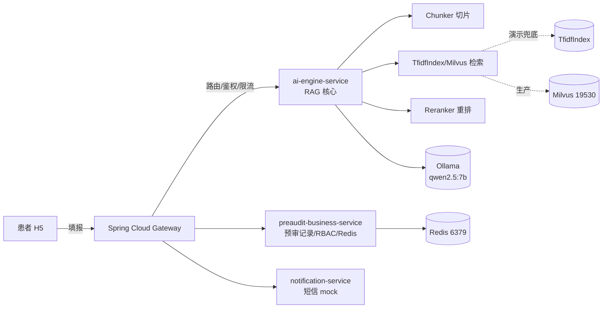

# 🏥 某地政务慢特病 AI 预审 · RAG 检索评估工程

> 把「能跑通的 Dify 应用」升级为「能讲深的 AI 工程作品」——含 RAG 评估脚本、切片 / 重排对比实验、微服务架构与可交互 Demo。


---

> **AI 应用落地工程师面试作品集** —— 把"会用 Dify"升级为"懂 AI 工程"。
> 覆盖：RAG 检索增强 · 切片策略实验 · 重排序（rerank）· 评估量化 · 本地大模型部署。
> 数据均为**模拟**，不含任何真实患者信息。

## 一句话亮点

不仅"能跑"，更"能讲深"：本仓库提供**可量化的 RAG 评估脚本**，用真实数字回答"切片切多大、要不要 rerank、模型怎么选"，而不是凭感觉。

## 特性

- 🔍 **零依赖 RAG 引擎**（`rag_core/`）：切片 → 检索 → 重排 → 生成，纯标准库实现，开箱即跑
- 📊 **RAG 评估**（`run_eval.py`）：输出 Recall@k / MRR / HitRate 真实对比
- 🧪 **切片粒度实验**：200 字 vs 500 字，有数据结论
- 🔁 **重排序模块**（`Reranker`）：已抽象接口，生产环境一行替换 cross-encoder
- 💬 **交互 Demo**（`app.py`，Gradio）：面试当场可玩
- 🐳 **容器编排**（`docker-compose.yml`）：Redis + Ollama 一键起

## 架构图



> 本仓库 `rag_core/` 即 `ai-engine-service` 的 RAG 核心；本地演示用 `TfidfIndex` 兜底，生产环境将检索替换为 Milvus，接口一致。

## 目录结构

```
preaudit-rag-engine/
├── README.md
├── requirements.txt
├── docker-compose.yml          # Redis + Ollama 一键起
├── Dockerfile
├── run_eval.py                 # 一键跑评估 + 切片/重排对比
├── app.py                      # Gradio 交互 demo
├── rag_core/
│   ├── chunker.py              # 切片（支持不同粒度 + overlap）
│   ├── retriever.py            # TF-IDF 检索（可替换 Milvus）
│   ├── reranker.py             # 重排序（预留 cross-encoder）
│   ├── generator.py            # Ollama 生成（mock 可离线）
│   └── eval.py                 # HitRate / Recall / MRR / Precision @k
├── data/
│   ├── policy_docs/            # 政策语料（16 篇，由 build_corpus.py 从真实表格/原型抽取）
│   ├── interference/           # 4 篇干扰文档（其它地区/病种/流程/待遇类）
│   ├── legacy_mock/            # 旧版模拟文本（已移出检索库，仅留档）
│   ├── sources.md              # 语料逐条来源台账（生成）
│   ├── eval_questions_v2.json  # 38 题题库，gold 精确到文档并附原文依据
│   └── eval_questions.json     # v1 旧题库（15 题，仅作对照）
├── build_corpus.py             # 从真实材料重建语料（可复跑）
├── tests_eval.py               # 指标边界测试（20 项断言）
└── docs/
    ├── architecture.md         # 完整技术架构 + 微服务拆分
    └── experiments.md          # 切片/重排实验记录
```

> 评估结论见 **[RESULTS.md](RESULTS.md)**（含与旧版 1.000 的对照复算）。

## 快速启动

```bash
# 0) 重建语料（可选，仓库已附带生成结果）
python build_corpus.py

# 1) RAG 评估（零依赖，标准库即可，直接出数字）
python run_eval.py

# 2) 指标边界测试
python tests_eval.py

# 3) 交互 demo（需 gradio）
pip install gradio
python app.py        # 浏览器打开 http://localhost:7860
```

## 核心实验结论（v2.1，确定性重建）

数据：16 篇真实材料抽取的政策语料（12,299 字）+ 4 篇干扰文档（479 字）+ 38 道题。
k 分 3/5/10 三档，同时报 HitRate / Recall / MRR / Precision。

**溯源信息不参与切分**：`SOURCE:` / `POLICY:` 等全部存于 `data/sources.json`，
正文只含政策内容。因此改出处、脱敏地名都不会影响指标，结果可确定性复现（已验证逐字节一致）。

**切片粒度**（仅向量检索，k=5）：

| 切片 | chunk 数 | HitRate@5 | Recall@5 | MRR@5 |
|---|---|---|---|---|
| 200 字 | 76 | **0.947** | 0.237 | 0.625 |
| 300 字 | 52 | 0.921 | 0.373 | 0.621 |
| **500 字** | 36 | 0.921 | **0.490** | **0.639** |

→ 切片越小越容易「碰到」相关文档（HitRate 高），但知识点被切碎、召回不全（Recall/MRR 低）。
500 字在 Recall / MRR 上最优，生产建议 300–500 字 + 句边界 + overlap。

**重排序（rerank）**：200 字切片 MRR@5 从 0.625 → 0.651（+2.6 点），
但 500 字切片反而全面下降（HitRate 0.921→0.895，Recall 0.490→0.469）。
原因是 `Reranker` 的交互分（BM25）与第一阶段 TF-IDF **同源**，同源精排不可能带来数量级提升 ——
这恰好说明 rerank 的价值必须建立在「语义召回 + cross-encoder 精排」的双阶段架构上。
详见 [RESULTS.md](RESULTS.md) 第 3.5 节。

> ⚠️ 旧版曾写「HitRate@5 = 1.000 / Recall@5 = 1.000」，那是在 5 篇 1,473 字语料上
> top-5 等于全库召回导致的**算术必然**，已撤回。旧版中间态的「0.974 / 0.549 / 0.715」
> 也撤回——实测发现它依赖 `SOURCE:` 行的字符长度（改一个地名就能让切片边界漂移、指标掉 0.03），
> 不可复现。复算与受控实验见 [RESULTS.md](RESULTS.md) 第四节。

## 模型选型：为什么是 qwen2.5:7b

| 维度 | 说明 |
|---|---|
| 部署成本 | 7B 可在 16G 显存 GPU，量化（q4_K_M）后甚至可 CPU 跑，适合政务内网私有化 |
| 中文能力 | 通义千问中文基准领先，政务/医疗问答质量满足预审 |
| 结构化输出 | 原生支持 function calling / JSON 模式，预审结论可结构化落库 |
| 生态 | Ollama 一键部署，bge-m3 嵌入同生态，RAG 组合成熟 |
| 取舍 | 14B/72B 精度高但部署贵；1.5B/3B 精度不足。7B 是精度/成本甜蜜点 |

## 面试能讲清的 3 个难点

1. **为何拆 Spring Cloud 而非单体**：预审/AI/通知解耦，AI 引擎可独立扩缩容
2. **RAG 召回不准怎么调**：切片粒度（实验已验证）→ top-k → 重排序（rerank）
3. **Redis 缓存一致性**：材料更新删缓存（Cache-Aside），避免脏读

## 脱敏说明

本项目为教学/作品集用途，**全部数据均为模拟**（姓名/身份证/手机号/机构名均虚构）。
真实部署时请将 `data/policy_docs_real/` 加入 `.gitignore`，绝不提交真实患者数据。

## License

MIT（模拟数据仅供演示）。
